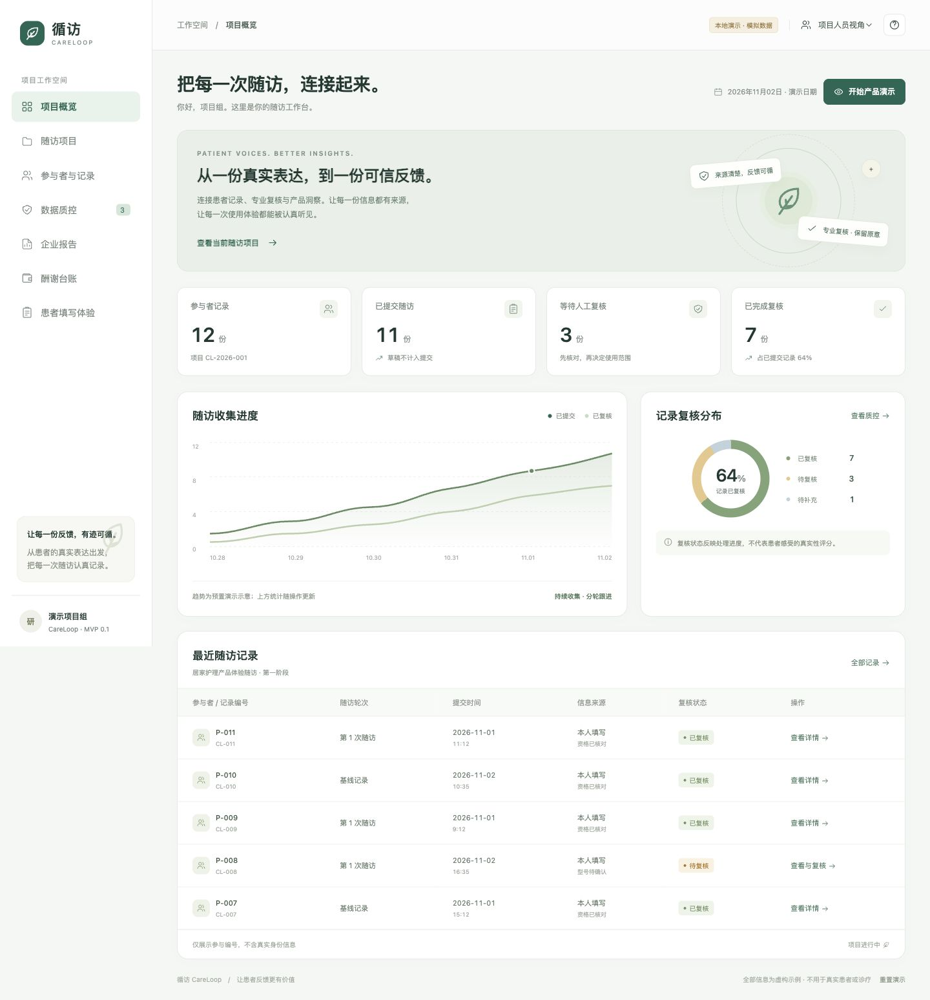

# 循访 CareLoop

护理产品体验随访平台的本地前端 MVP，用于课程、项目讨论和路演演示。

**当前是纯前端原型：没有后端、真实账户、患者数据、身份验证、真实付款或企业订单。全部初始记录及产品型号均为虚构。请勿输入真实患者信息。**



## 本地打开

下载完整项目后，双击 `index.html`，即可在浏览器中运行。不需要安装依赖、不需要联网、不需要构建。

macOS 可双击 `启动演示.command` 打开。也可以在项目目录运行一个仅供本机访问的静态文件服务器：

```bash
python3 -m http.server 8765 --bind 127.0.0.1
```

然后访问 <http://127.0.0.1:8765>。这只是静态文件服务，不包含业务后端或接口。按 Ctrl+C 停止。

## 可以演示什么

| 页面 | 交互 |
| --- | --- |
| 项目概览 | 动态统计、复核状态分布、最近记录、演示指南 |
| 随访项目 | 项目说明、交付范围、模拟邀请码 |
| 参与者与记录 | 搜索、状态筛选、查看记录和历史、CSV导出 |
| 数据质控 | 逻辑/时长/缺失规则开关、复核意见、请求补充、处理历史 |
| 患者填写体验 | 草稿、表单验证、矛盾示例、提交前检查、模拟记录提交 |
| 企业报告 | 根据已复核记录生成汇总、文本报告下载、打印或保存PDF |
| 酬谢台账 | 独立登记模拟发放、防重复登记、台账CSV导出 |

右上角可切换项目人员、患者、企业三个视角。**角色切换仅用于页面演示，不构成真实权限隔离。**

## 推荐的三分钟演示

1. 在首页点击“开始产品演示”，进入患者填写。
2. 点击“试试矛盾记录”，勾选参与说明，再点击“检查并提交”。
3. 查看待确认事项，点击“确认提交模拟记录”。
4. 进入工作台，打开最新记录，填写处理意见，完成复核或请求补充。
5. 切换企业视角，查看汇总与报告；再切回项目人员查看独立的酬谢台账。
6. 使用页脚“重置演示”恢复初始状态。

详细脚本见 [演示指南](docs/DEMO.md)。

## 数据与限制

- 使用原生 HTML、CSS、JavaScript；无框架、CDN、外部字体、跟踪或网络请求。
- 操作和草稿存放在当前浏览器的 `localStorage`。不同浏览器、`file://` 与 HTTP 地址的数据相互独立。
- 浏览器禁止本地存储时，演示仍可运行，但关闭或刷新可能丢失操作。
- 图表中的收集趋势是预置示意；统计、复核分布和企业体验分布随操作更新。
- 填写时长30秒仅为演示阈值，不能用于真实患者排除。
- 规则发现的是“需要确认的信息”，不判断患者说谎，不自动取消酬谢。
- 企业报告中的复核不等于临床证实，也不表示已经取得机构或患者授权。
- 本地存储可被使用者查看和修改，不是安全医疗数据仓库；真正上线需重新设计服务端验证、授权、访问控制和审计。

## 文件结构

```text
careloop-mvp/
├── index.html              # 页面入口
├── styles.css              # 视觉和响应式布局
├── app.js                  # 页面、模拟记录、交互和规则
├── 启动演示.command         # macOS打开入口
├── docs/
│   ├── overview.png        # 实际页面截图
│   ├── DEMO.md             # 演示流程
│   ├── PRODUCT.md          # 产品范围与后续路线
│   └── QA.md               # 验证记录
└── .gitignore
```

## 下一阶段

先明确一个合作科室、一家企业、一个数据用途，以及机构和参与者相关安排，再决定是否开发真实采集后端。详见 [产品草案](docs/PRODUCT.md)。

本仓库仅含本项目新增代码、模拟数据和说明，不包含老师原始文档、真实医疗材料、密钥或其他本地项目。
